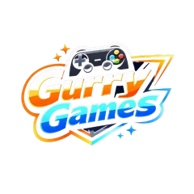

# GurryGames v2 — build contract (teaser scope)

Static site. No framework, no build step, no npm deps. Every page links `/css/gurry.css`
and `/js/site.js` (defer). **No `<style>` blocks, no inline `style=`, no inline event handlers.**

Host: GitHub Pages on `https://gurrygames.xyz`, served from repo root.
All internal URLs root-relative and explicit: `/`, `/404.html`.

## 1. Scope

v2 relaunch is a **single-page studio teaser**. The four v1 game pages and the prank page are
moved to `archive/v1/` and are **not** linked, indexed or referenced. No game titles, posters,
download links or trailers appear anywhere in the live site. The only public statement about
games is the "Games coming soon" section.

## 2. Brand

Same palette as v1. Horror label, not SaaS: 2px max radii, hairline borders, uppercase
letterspaced labels, mono micro-type, film grain, vignette, crimson light.

```
--bg        #0f0404   page
--bg-soft   #170707
--panel     #220d0d
--panel-2   #2a0f0f
--ink       #ffecec   primary text
--muted     #d49b9b   body text
--dim       #a06a6a   fine print
--accent    #ff4d4d
--accent-st #ff3333
--line      rgba(255,80,80,.14)
--line-2    rgba(255,80,80,.28)
--glow      rgba(255,51,51,.35)
```

Fonts, one Google request:
`family=Inter:wght@300;400;600;800&family=Oswald:wght@400;600;700&display=swap`
Display = `Oswald, Impact, sans-serif`. Body = `Inter, system-ui, sans-serif`.
Micro labels = `ui-monospace, SFMono-Regular, Menlo, Consolas, monospace`, uppercase,
`letter-spacing:.18em`, 11px, colour `--accent` or `--dim`.

## 3. Files

| Path | Owner |
|---|---|
| `archive/v1/` (game pages, vote page, manifest) | ARCHIVE agent |
| `css/gurry.css` | CSS agent |
| `js/site.js` | JS agent |
| `index.html` | orchestrator |
| `404.html`, `robots.txt`, `sitemap.xml`, `README.md` | PLUMBING agent |
| `docs/v2-spec.md` | this file |

## 4. Images available (only these are used)

- `/assets/opt/logo.webp` 240×240 — nav badge, 40×40
- `/assets/opt/king.webp` 1920×1280 — studio art
- `/assets/opt/og-home.jpg` 1200×630 — social card

Everything else in `assets/` stays for the later remaster but is not loaded by any live page.

## 5. Header — copy verbatim

```html
<a class="skip" href="#main">Skip to content</a>
<header class="site-nav" id="siteNav">
  <div class="nav-inner">
    <a class="nav-brand" href="/" aria-label="Gurry Games home">
      
      <span class="nav-word">GURRYGAMES</span>
    </a>
    <nav class="nav-links" id="navLinks" aria-label="Main">
      <a href="/#coming-soon">Coming soon</a>
      <a href="/#studio">Studio</a>
    </nav>
    <button class="nav-toggle" id="navToggle" type="button" aria-expanded="false"
            aria-controls="navLinks" aria-label="Open menu">
      <span></span><span></span>
    </button>
  </div>
</header>
```

## 6. Footer — copy verbatim

```html
<footer class="site-foot">
  <div class="wrap foot-grid">
    <div class="foot-brand">
      <span class="foot-mark">GURRYGAMES</span>
      <p class="foot-tag">The king of horror games. Independent, atmosphere first, Windows PC.</p>
    </div>
    <nav class="foot-nav" aria-label="Footer">
      <a href="/#coming-soon">Coming soon</a>
      <a href="/#studio">Studio</a>
    </nav>
    <div class="foot-meta">
      <p class="foot-status">Catalogue in rebuild</p>
      <p>© <span id="year">2026</span> Gurry Games · Site v2</p>
    </div>
  </div>
</footer>
<script src="/js/site.js" defer></script>
```

## 7. Class inventory — every class must exist in `css/gurry.css`

**Base**: `wrap` `section` `section--tight` `sec-head` `sec-idx` `eyebrow` `skip` `sr-only` `divider`
**Buttons**: `btn` `btn-primary` `btn-ghost` `btn-sm` `btn-block`
**Nav**: `site-nav` `is-stuck` `nav-inner` `nav-brand` `nav-word` `nav-links` `nav-toggle` `is-open` `body.nav-open`
**Footer**: `site-foot` `foot-grid` `foot-brand` `foot-mark` `foot-tag` `foot-nav` `foot-meta` `foot-status` `foot-ver`
**Hero**: `home-hero` `hero-glow` `hero-grid` `hero-title` `hero-title-line` `hero-lede` `hero-cta` `hero-note` `hero-frame`
**Ticker**: `ticker` `ticker-track`
**Coming soon**: `coming-grid` `coming-card` `coming-frame` `coming-num` `coming-bars` `coming-bar` `coming-label` `coming-note`
**Studio**: `studio-grid` `studio-copy` `studio-lede` `studio-body` `studio-art`
**Error page**: `error-page` `error-code` `error-copy`
**Motion**: `reveal` `is-in`

## 8. Page structure (index.html)

```
header
main#main
  section.home-hero
    .hero-glow
    .hero-frame (decorative corner ticks, aria-hidden)
    .wrap > .hero-grid
      p.eyebrow  "Independent horror studio"
      h1.hero-title > span.hero-title-line "GURRY" + span.hero-title-line "GAMES"
      p.hero-lede  one sentence
      .hero-cta    .btn.btn-primary → #coming-soon "See what's coming"
                   .btn.btn-ghost   → #studio "The studio"
      p.hero-note  "Windows PC · Relaunching soon"
  .ticker (aria-hidden="true") > .ticker-track (content duplicated for the loop)
  section#coming-soon.section
    .wrap > .sec-head (.sec-idx "01" + h2 "Games coming soon")
    p intro
    .coming-grid > 3 × article.coming-card
      .coming-frame (aria-hidden) > span.coming-num 01 | .coming-bars > 3 × i.coming-bar
      h3.coming-label "Untitled project 01"
      p.coming-note "In development"
  section#studio.section
    .wrap > .studio-grid
      .studio-copy > p.eyebrow "02 / Studio" + h2.studio-lede + .studio-body (2 paragraphs)
      figure.studio-art > img king.webp 1920×1280 alt="Gurry Games key art" loading=lazy
footer
```

Exactly one `h1`. Heading order h1 → h2 → h3. No game names anywhere.

## 9. Copy voice

Restrained, confident, specific. No invented dates, versions, awards, team size or socials.
No "dive in", "unleash", "embark", "elevate". Short sentences mixed with long ones.
The tone is a label coming back from silence — not a startup launching a product.

## 10. JS contract (`js/site.js`, no deps, IIFE, strict, defer)

- `#navToggle` toggles `body.nav-open`, `.is-open`, `aria-expanded`, swaps `aria-label`
  Open/Close menu; Esc closes and refocuses the toggle; clicking a link or outside closes;
  crossing ≥760px force-closes.
- `#siteNav` gets `.is-stuck` when `scrollY > 24`, rAF-throttled passive listener, run on load.
- `.reveal` via IntersectionObserver (threshold .15, rootMargin "0px 0px -8% 0px"), add `.is-in`,
  unobserve. Stagger siblings with `--reveal-delay` 0–300ms. If unsupported or reduced motion,
  reveal everything immediately.
- `#year` → current year.
- Guard every query; no page should throw because an element is missing.
- No modal code, no analytics, no storage, no network.

## 11. Definition of done

- No horizontal overflow at 320 / 390 / 768 / 1440.
- Every image has `width`/`height` and `alt`; below-fold images lazy.
- All focus states visible; 44px minimum touch targets.
- No `<style>`, no `style=`, no `on*=` anywhere in live HTML.
- `robots.txt` allows `/` and disallows `/archive/`.
- `sitemap.xml` contains only `https://gurrygames.xyz/`.
- `404.html` is styled and links home; it does not list archived games.